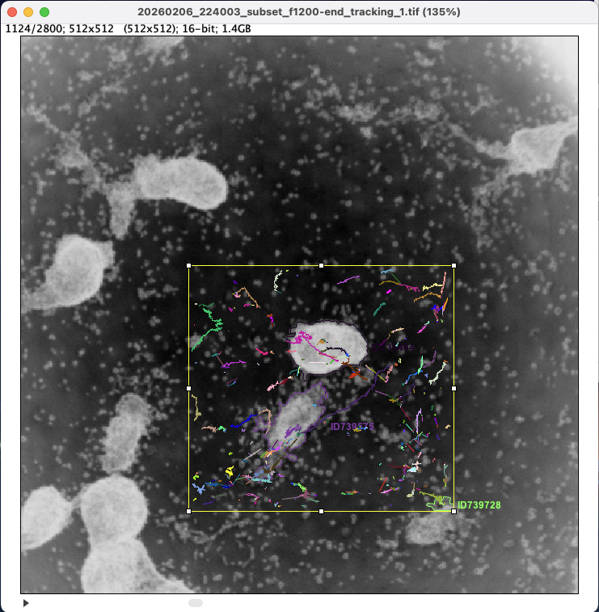
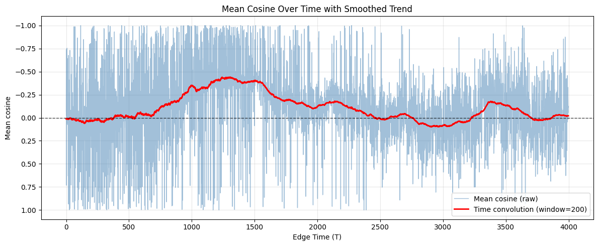
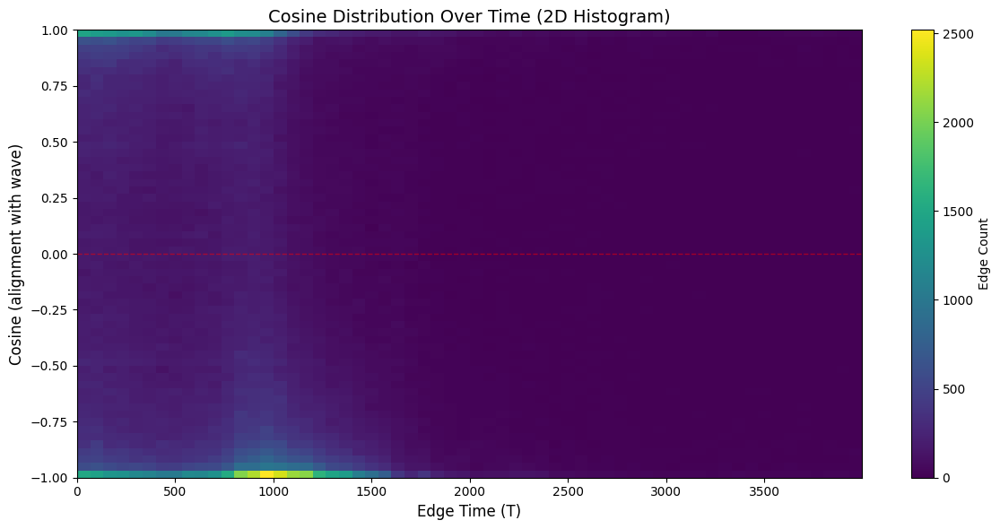
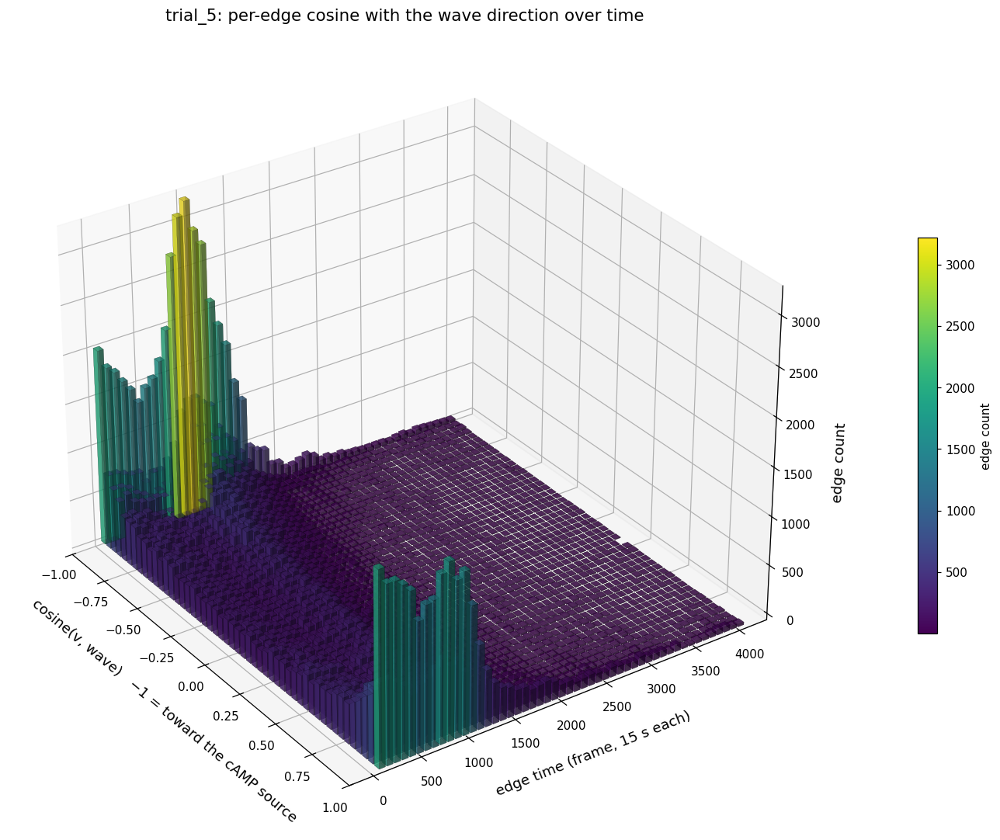
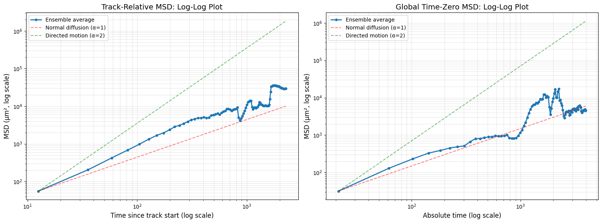
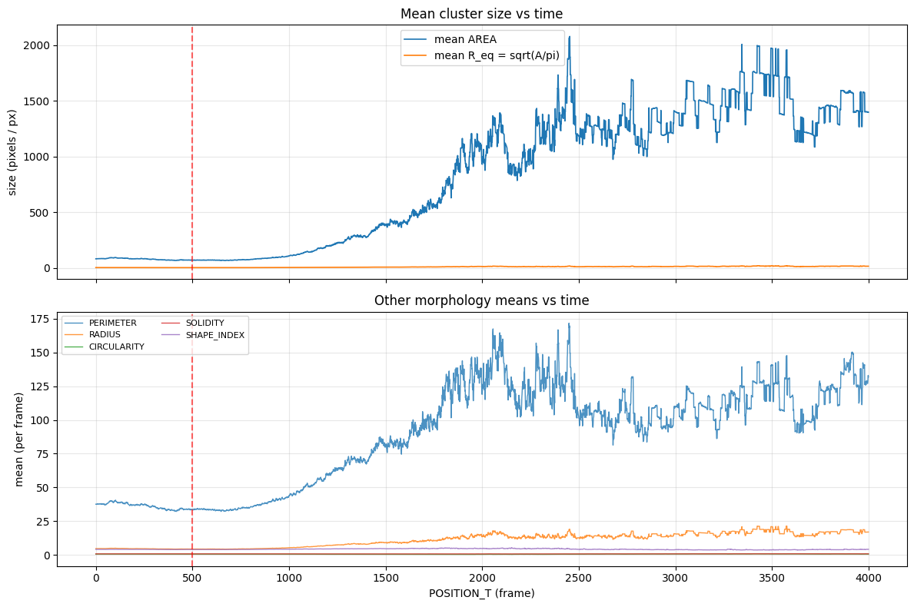
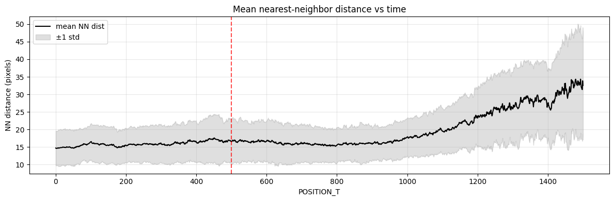
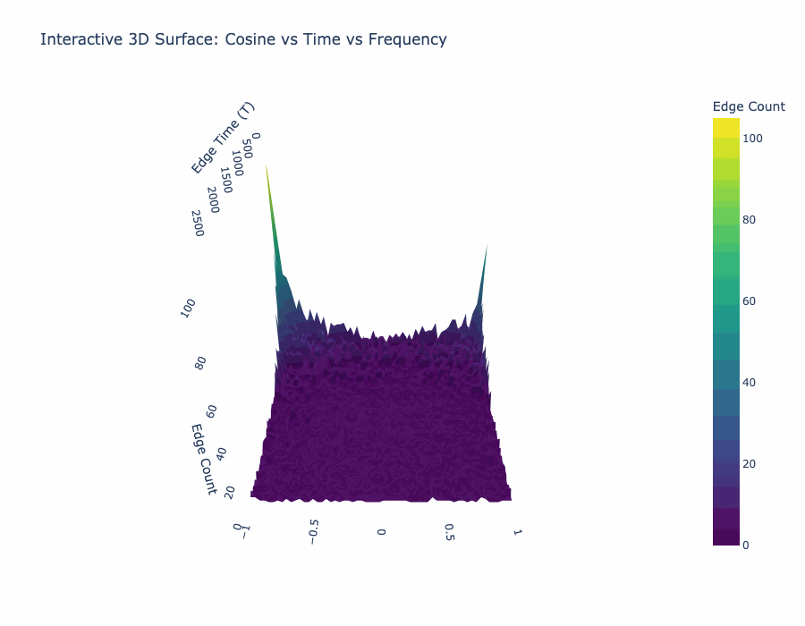

# Dictyostelium Motility and Cell Aggregation Dynamics

Biophysics and computer vision research project under *Dr. Wouter-Jan Rappel* and *PhD student Yi-Chieh Lai*, **UCSD Department of Physics**.


https://github.com/user-attachments/assets/11973e49-79f4-4c99-9894-a98e8fbb09cd


<p align="center"><sub>
  The full 16.7 h movie lifted into 3D (time-convolved channel, every 2nd frame at 30 fps).
  Each cell or cluster is an anisotropic Gaussian whose height grows with its size, so streams fuse into tall aggregation mounds.
  The 2D frame is inset top-right. See <a href="#3d-lift-simulation">3D lift</a>.
</sub></p>

## Motivation

*Dictyostelium discoideum* is a social amoeba. When food runs out, thousands of individual cells signal to each other and aggregate:

1. A starving cell secretes **cyclic AMP (cAMP)**.
2. Neighbours that sense it move up the gradient (**chemotaxis**) and relay it by secreting their own cAMP.
3. This sets up periodic **cAMP waves** that sweep across the population.
4. Over hours the cells organize into **streams**, then **mounds**, a migrating slug and finally a fruiting body.

**Can we describe the mechanics and forces of *Dictyostelium* under starvation from imaging alone?** Concretely:

- How strongly does a cell's motion respond to the passing cAMP wave? Do cells move against the wave, toward the source, and when?
- Do cells feel an effective "force" toward aggregation centers, and how does it depend on distance and on the size of the cluster?
- Is the motion diffusive, directed or something in between, and how does that change as the system goes from single cells to streams to mounds?
- How do the waves themselves behave (direction, speed, period, area), and how do they couple to the motion?

## Data

All current work uses one high-density movie, **"Capture 4 - Position 1"**. It has 4000 frames of 512 × 512 px at **15 s per frame** (~16.7 h) and **3.73 µm per pixel**. The cells move and aggregate toward the **top-right**, where the food/cAMP source is. A low-density movie is expected next.

The cells carry **Flamindo2**, a reporter that goes **dark when intracellular cAMP is high**. Each wave therefore shows up as a **dark band sweeping from the top-right to the bottom-left**. That band is the signal we care about, but it also makes cells vanish under thresholding. Three renderings of the same movie are used:

| channel | what it shows | used for |
|---|---|---|
| **c0** | fluorescence: bright cells on dark, **with the cAMP wave** | wave detection |
| **c1** | dark cells on white, **no wave** (inverted before tracking) | tracking, trial_4 |
| **highdensity_timeconvol** | c0 convolved over time: wave removed, far more stable clusters | tracking, **trial_5 (current best)** |

## Approach

1. **Preprocess.** Export TIFF stacks to per-frame PNG/JPG (`preprocessor/`), invert c1 so cells are bright on dark, and use the time-convolved movie to suppress the wave.
2. **Track** in Fiji/TrackMate. A thresholding detector finds cells and clusters, and a Kalman-filter tracker links them across frames, including merge and split events as clusters fuse. Each run exports spots, edges and tracks CSVs to `results/trial_N/`.
3. **Analyze** the tracks (`analysis/edge-features-*.ipynb`):
   - per-edge velocities;
   - the **cosine between each velocity and the wave direction** (−1 = moving against the wave, toward the source; this is our chemotaxis-index proxy);
   - velocity components parallel and orthogonal to the wave;
   - radial and tangential motion relative to the final aggregate;
   - time-binned statistics, mean squared displacement, cluster size and nearest-neighbour distance.
4. **Detect the cAMP waves** in c0 with a fine-tuned segmentation model ([below](#camp-wave-detection)).
5. **Lift to 3D** for intuition about aggregation ([below](#3d-lift-simulation)).

<p align="center">
  
  
</p>

Detector and tracker parameters, the original imaging problems and the trial_3 proof-of-concept findings are in **[docs/processing_pipeline.md](docs/processing_pipeline.md)**.

## Results

Current results come from **trial_5** (time-convolved movie, full 4000 frames), analysed in `analysis/edge-features-3.ipynb`. trial_4 (c1) is in `edge-features-2.ipynb`.

**Alignment with the wave over time.**

- The mean cosine stays near 0 for the first ~800 frames.
- It swings toward −0.4 between frames ~900 and ~1600. Cells are on average moving against the wave, toward the top-right source, which is when directed streaming becomes visible in the movie.
- It relaxes back to ~0 once the aggregates have formed.

<p align="center"></p>

**Distribution of per-edge cosine over time.**

- Edges pile up at cosine ±1, so most steps are nearly parallel or anti-parallel to the wave rather than random.
- The −1 side shows **two peaks**: one in the first ~300 frames and one around frames ~800–1100.
- The second matches the visible onset of chemotaxis. The first is unexplained and is under investigation (see [problems](#current-problems-and-limitations)).

<p align="center">
  
  
</p>

**Motion statistics and aggregation.**

- **MSD:** the ensemble MSD grows as ~t<sup>1.3</sup>, between diffusion (α = 1) and directed motion (α = 2).
- **Cluster size:** the mean cluster area is flat for ~800 frames, then grows ~20× by frame ~2000.
- **Spacing:** the nearest-neighbour distance between clusters starts climbing at frame ~1100. That is exactly when wave detection begins to fail, because the growing gaps between clusters look like dark wave bands.

<p align="center"></p>
<p align="center">
  
  
</p>

An earlier view of the same question (trial_3, interactive Plotly surface of cosine × time × count):

<p align="center"></p>

## cAMP wave detection

**Motivation.** The wave is both the obstacle and the signal:

- It is why cells disappear when c0 is thresholded.
- It is also the stimulus the cells respond to. Relating motion to the signal needs the wave's position, direction, speed and timing in every frame.

Classical thresholding cannot separate a dark wave band from dark background, so we trained a detector.

**Method.**

- **Labels:** about 100–200 frames of c0, annotated by hand with polygon masks (SAM3-assisted in Roboflow). These include null frames with no wave.
- **Training:** RF-DETR / YOLO instance-segmentation models fine-tuned on Roboflow, reaching validation accuracy in the mid-to-high 90s.
- **Inference:** run on all 4000 frames with `roboflow/images/workflow.py`.

**Results.**

- Waves appear from about **frame 260**, with 1–4 visible at once.
- Their direction rotates over the movie, from a top-down slant to mostly right-to-left, and their speed changes.
- Detection is reliable up to about **frame 1100–1250**. After that, the widening gaps between clusters are indistinguishable from waves.
- Even before that, some frames drop a wave or part of one. This is why a per-frame wave velocity/area series (`roboflow/images/wave_velocity_plot.py`) is not yet trustworthy.

<div align="center">
https://github.com/user-attachments/assets/4e83ebea-2074-4ec6-8304-3aab632843b5
</div>

**Further applications.**

- **Robust training past frame ~1250.** Smooth each frame spatially, define a per-pixel **phase** of the oscillation (e.g. Hilbert transform of each pixel's intensity over time) and train on those. Also annotate late frames as wave-free negatives.
- **Wave kinematics.** Measure direction, speed, period and area over time once detections are consistent between frames.
- **Conditioning chemotaxis on the wave.** Estimate the probability of high chemotactic alignment given wave presence or phase, to separate wave-driven motion from drift toward aggregates.
- **Tracking support.** Wave masks could gate or bridge tracks in c0 while cells are dark.
- **Other movies.** Generalize to the upcoming low-density data.

## Current problems and limitations

1. **Wave detection breaks down after frame ~1100–1250.**
   - Inter-cluster gaps look like waves, and even earlier frames occasionally drop a wave or part of one.
   - Plan: phase-based preprocessing (spatial smoothing, Hilbert transform), late-frame negative annotations, then retraining.
2. **The early double −1 cosine peak.**
   - The ~800–1100 peak is expected. The peak in the first ~300 frames is not, since no directed motion is visible then.
   - Next checks:
     - compute velocity over Δt = 3–5 frames instead of per edge;
     - bin time more coarsely;
     - query the high-alignment edges/spots near t = 0;
     - check whether the peak is a binning or resolution artifact.
   - Note: the *smooth-surface* variant of this plot (`plot_3d_distribution` in `analysis/utils.py`) transposed its counts, swapping cosine and time, until 2026-10-15. The bar chart shown above and the 2D histograms were not affected.
3. **Tracking identity.**
   - Clusters that merge get new IDs and can split again right after. Per-edge velocities are therefore noisy, and per-track averages are more stable.
   - Acceleration is deliberately not analysed, because differentiating noisy velocities amplifies the noise.
4. **Scope of the data.**
   - There is only one high-density movie so far.
   - The field of view is much smaller than the dish, so cells leave the frame and the wave origin is never visible.
   - trial_4 positions are in µm and trial_5 in pixels, and trial_5 is stored time-reversed; the notebooks handle both.

## Repository layout

| path | contents |
|---|---|
| `analysis/` | notebooks: `edge-features-3.ipynb` (trial_5, current), `edge-features-2.ipynb` (trial_4), `edge-features.ipynb` (trial_3); `utils.py` plotting helpers |
| `results/trial_N/` | TrackMate spots/edges/tracks CSVs (trial_5's are too large for GitHub and stay local) |
| `preprocessor/` | TIFF → PNG/JPG, inversion, windowing, frames → MP4/TIFF |
| `roboflow/` | wave inference (`images/workflow.py`), tracking and geometry of detections, RF-DETR training notebook |
| `simulation/` | 3D lift of the movie: Gaussian decomposition, web viewer, MP4 renderer |
| `docs/` | processing pipeline, TrackMate detector/tracker notes, experiment logs, meeting notes |
| `assets/` | figures and videos used here |
| `readme_old.md` | the previous README (trial_3 era) |

## Setup

```bash
python3 -m venv venv
source venv/bin/activate
pip install -r requirements.txt
jupyter notebook          # open analysis/edge-features-3.ipynb; notebooks chdir to the repo root
```

Frame exports (gitignored, rebuilt from the TIFFs in `data/raw/`):

```bash
python preprocessor/tiff_to_png_jpg.py --raw-dir data/raw --output-dir data       # data/png/<cN>/, data/jpg/<cN>/
python preprocessor/invert.py --input-dir data/png/c1 --output-dir data/jpg/c1_inverted
python preprocessor/jpgs_to_mp4.py --input-dir <frames> --output <out.mp4> --fps 60 --codec avc1 --label
```

The Roboflow scripts read credentials from a repo-root `.env`. Copy `.env.template` and fill in `ROBOFLOW_API_KEY`.

```bash
python roboflow/images/workflow.py            # inference on data/jpg/waves -> roboflow/images/results/<date>/
python roboflow/images/tracker.py --offline --results-dir roboflow/images/results/2026-05-16_232640 \
  --waves-dir data/jpg/waves --output tracked.mp4
```

## 3D lift (simulation)

`simulation/` turns each frame into **one anisotropic Gaussian per cell or cluster**:

- Gaussians are fitted from the image itself (watershed regions merged across shallow saddles, then intensity-weighted moments) or taken from the TrackMate spots.
- Each one is lifted into a third dimension: as a **height field**, a **metaball iso-surface** (nearby cells fuse into blobs) or **3D Gaussian splats**.
- The height model is selectable: *mound* (height ∝ cluster radius), *intensity* or *mass*.

Details are in [`simulation/README.md`](simulation/README.md).

```bash
python -m simulation.build                 # ~13 min: Gaussian models for c1 (inverted) and timeconvol, all 4000 frames
python -m http.server 8000                 # from the repo root, then open http://localhost:8000/simulation/viewer/
python -m simulation.render --source timeconvol --mode surface        # 1080p MP4 like the one at the top
python -m simulation.render --source c1_inverted --mode metaballs --orbit 50
```

The viewer streams the data in chunks and has:

- a time slider with playback (Space, ←/→);
- live switching of model, render mode, height model, colour (height, TrackMate track or image), z exaggeration and σ;
- PNG snapshots.

Generated data and renders go to `simulation/output/` (gitignored).
