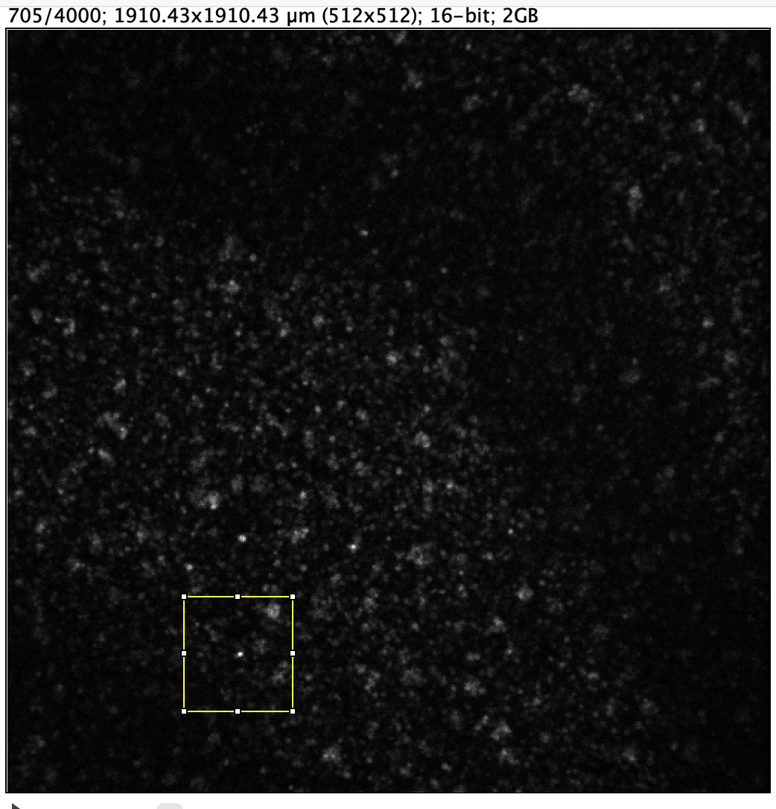
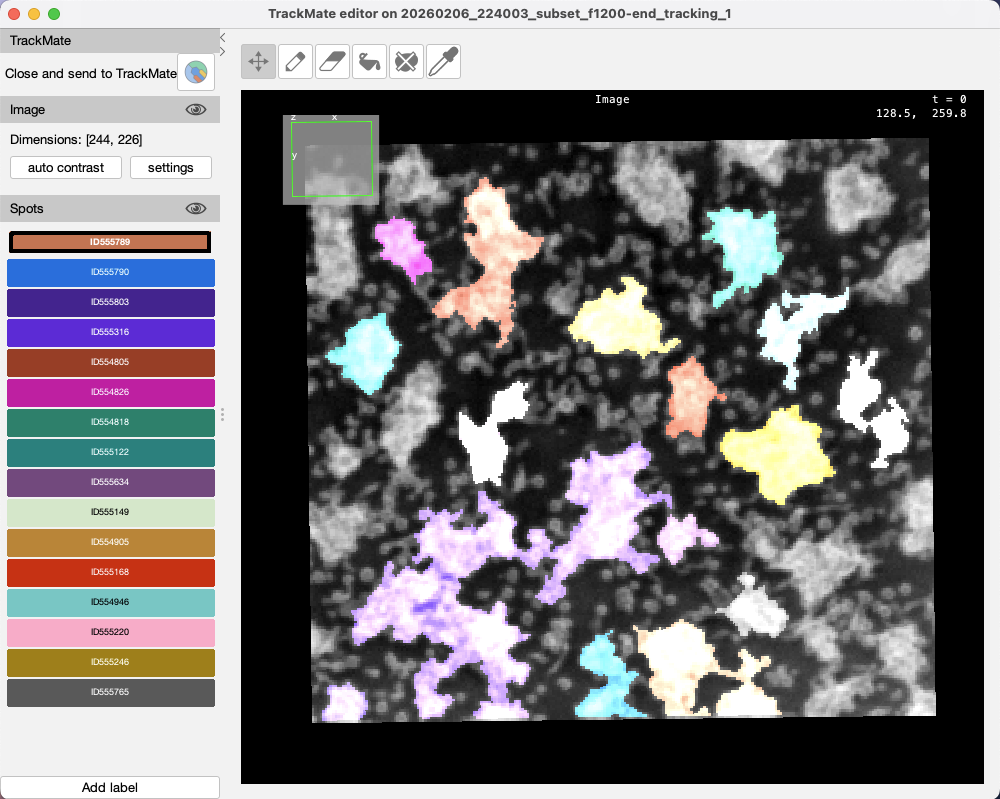
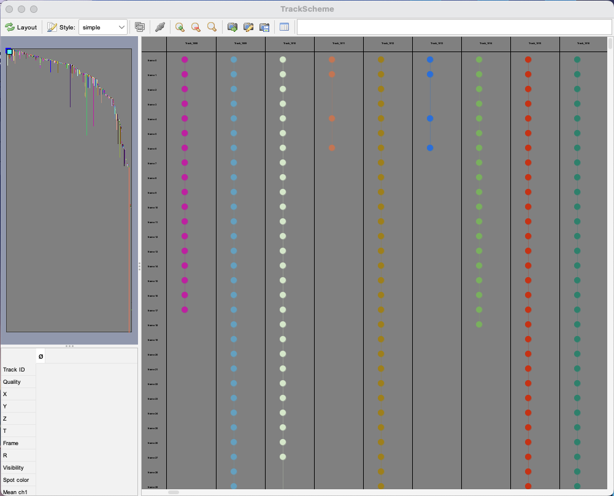
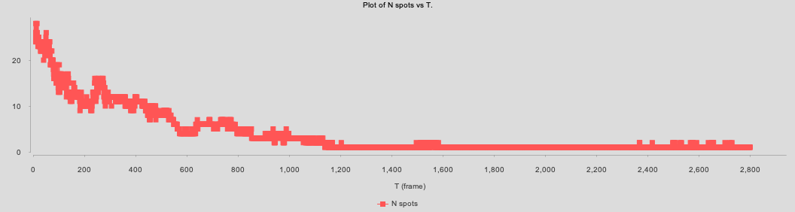
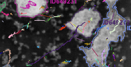

# Imaging problems and the tracking pipeline

The [main README](../README.md) has the project overview, current results and setup. This document is the detail behind them:

- why the raw movie is hard to track;
- the Fiji/TrackMate pipeline and its parameters for each trial;
- the limitations seen during the trial_3 proof of concept.

It was moved out of the original README, which is archived as [`readme_old.md`](../readme_old.md).

## The imaging problem

The cells carry a fluorescent reporter, **Flamindo2**, which goes **dark when intracellular cAMP is high**.

- **What cAMP does.** Cyclic AMP is the chemoattractant that starving *Dictyostelium* respond to. Waves of it sweep over the cells periodically.
- **Signal relay.** A cell that senses high cAMP around its body starts making and secreting cAMP itself, so it turns dark too.
- **The band.** In the c0 channel this appears as a global **dark band moving from the top-right to the bottom-left** of the field of view.
- **Effect on thresholding.** Cells vanish and reappear as the band passes, which breaks frame-to-frame tracking.
- **Unknown wave origin.** The field of view is much smaller than the Petri dish, so cells can leave the frame and we cannot see where the waves start.
- **Wave direction.** It was measured in ImageJ as −151.97°, and the analysis uses the unit vector (−0.875, −0.485) in math coordinates.

### Early workarounds (proof of concept)

**1. Analyze a spatial/temporal window** of the movie between bands, before cells begin to disappear.

  

**2. Persist a track through a disappearance.** Freeze a cell's last position while it is dark and resume when it reappears, as long as it has not moved too far.

### What replaced them

- **c1 channel (trial_4).** c1 is the same movie without the dark wave: dark cells on a white background. It is pixel-inverted before tracking, so cells are bright on dark, and `preprocessor/invert.py` writes `data/jpg/c1_inverted/`.
- **Time-convolved c0 (trial_5).** `highdensity_timeconvol` smooths c0 over time. This removes the wave and makes clusters far more stable from frame to frame. It is the current best input.

## Tracking pipeline (Fiji / TrackMate)

The same five steps apply to every trial; the parameters below record what each trial used.

1. **Pixel inversion.** Only for c1: cells become bright against a dark background.
2. **Spatial and temporal windowing.** trial_3 used an ROI and frames 1200–4000; later trials use the full movie.
3. **Cell detection.** The thresholding detector with simplified contours, then a minimum-radius filter. The filter focuses on larger clusters and cuts down on small fragments that flicker in and out.
4. **Linking.** The **Advanced Kalman Tracker** ([`docs/trackers/AKT.md`](trackers/AKT.md)). It assumes near-constant velocity per object and supports merge/split events and gap closing, which matters because cells aggregate hierarchically.
5. **Export.** Spots, edges, tracks (and branches) CSVs go to `results/trial_N/`. TrackMate CSVs carry 4 header rows, so read them with `pd.read_csv(path, header=0, skiprows=[1, 2, 3])`.

Other detectors and trackers that were considered are summarized in [`docs/detectors/`](detectors) and [`docs/trackers/`](trackers).

### Parameters per trial

| trial | input | detection | linking (AKT) | notes |
|---|---|---|---|---|
| trial_3 | c1, inverted, ROI X 154–397, Y 211–435, frames 1200–4000 | threshold 17604, radius ≥ 8.04 px | merge/split distance 5 (no penalties), initial search radius 30 px, Kalman search radius 10 px, linking max distance 30, max frame gap 5 | proof of concept; also exported `branches.csv` |
| trial_4 | c1, inverted, ROI cleared outside, full movie | threshold ~35–40 %, ~1.55 M spots, filter radius ≥ 17.51 µm (~177 k spots) | AKT | spots in µm; analysed in `analysis/edge-features-2.ipynb` |
| trial_5 | `highdensity_timeconvol`, full movie | threshold 99 | initial search radius 5, search radius 5, max frame gap 30 | **tracked on a time-reversed stack**, un-reversed in `analysis/edge-features-3.ipynb` cell 1; spots in px |

**trial_3 ROI geometry** (ImageJ units):

| Axis | Min | Max | Step (Δ) |
|------|-----|-----|----------|
| **X** | 154 | 397 | 1.00000 |
| **Y** | 211 | 435 | 1.00000 |
| **Z** | 0   | 0   | 1.00000 |
| **T** | 0   | 2799| 1.00000 |

  
  

> **Reproducibility.** Tracks can be reproduced from the parameters above, but track colors and cell IDs will differ between runs. The extracted data (positions, times) should be the same.
>
> Cropping with `preprocessor/window.py` drops ImageJ calibration (pixel width/height, voxel depth, frame interval), so TrackMate defaults them all to 1.

## Limitations seen in trial_3

1. **Inconsistent splitting/merging.**
   - When two cells merge, a new ID is assigned.
   - Thresholded contours can split again right away, creating new contours and IDs.
   - Some of this back-and-forth is unavoidable given how ambiguous the clusters are.
2. **Max-frame-gap trade-off.**
   - Too low, and tracks jump or vanish and IDs multiply.
   - Too high, and nearby but different cells get linked.

   
   
3. **Temporal pattern.** This works as a sanity check:
   - Early and middle frames split and merge constantly, which shows up in TrackScheme as a long horizontal band of new IDs.
   - Late frames stabilize into long continuous tracks once clusters fully aggregate.
4. **Few successors/predecessors.** `results/trial_3/*_branches.csv` records almost no split/merge links, so merge events may not be captured.

  

trial_3 output is in [`results/trial_3/`](../results/trial_3). There is also a [tracking video of frames 1200–4000 at 60 fps](https://drive.google.com/file/d/163sUff1nipgEXZRfvcQ-P1H_oR9RZeLi/view?usp=sharing).
